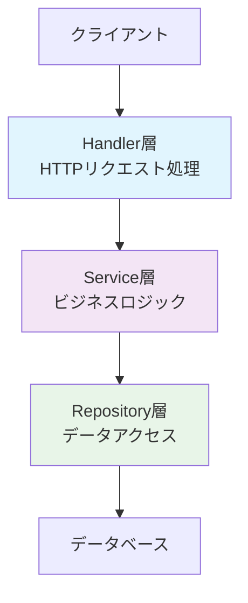

## 📐 **アーキテクチャパターン解説：Handler → Service → Repository**

### **基本的な考え方**

Handler → Service → Repository パターンは、**関心の分離（Separation of Concerns）** と **単一責任の原則（Single Responsibility Principle）** に基づいた、3層アーキテクチャの代表的な実装パターンです。



#### **設計哲学**
- **変更の影響を局所化**: 各層の変更が他層に波及しないように責務を明確に分離
- **テスタビリティの向上**: 各層を独立してテスト可能な構造
- **再利用性の確保**: ビジネスロジックを複数のエンドポイントで共有
- **保守性の向上**: 責務が明確で理解しやすいコード構造

---

### **各層の責務と役割**

#### **1. Handler層（プレゼンテーション層）**
**責務**: HTTPプロトコルの詳細とWebフレームワーク固有の処理

**具体的な役割**:
```go
// 例: AuthHandler.Login()
func (h *AuthHandler) Login(c *gin.Context) {
    // ✅ HTTPリクエストの解析・バリデーション
    var req LoginRequest
    if err := c.ShouldBindJSON(&req); err != nil {
        c.Error(errors.NewValidationError("request", "Invalid request format"))
        return
    }

    // ✅ Service層への委譲（ビジネスロジックは含まない）
    result, err := h.authService.Login(req)
    if err != nil {
        c.Error(err)
        return
    }

    // ✅ HTTPレスポンスの構築
    c.JSON(http.StatusOK, gin.H{
        "data":    result,
        "message": "Login successful",
    })
}
```

**Handler層の責務**:
- ✅ **HTTPリクエスト解析**: JSON/FormデータのGo構造体への変換
- ✅ **バリデーション**: リクエスト形式の基本的な妥当性チェック
- ✅ **Service層呼び出し**: ビジネスロジックの実行委譲
- ✅ **HTTPレスポンス構築**: 結果のJSON化、HTTPステータス設定
- ✅ **エラーハンドリング**: Service層のエラーをHTTPエラーに変換
- ❌ **ビジネスロジック**: 含めるべきではない（Service層の責務）
- ❌ **データアクセス**: 直接的なDB操作は禁止

#### **2. Service層（ビジネスロジック層）**
**責務**: ドメインの核となるビジネスルールとアプリケーションロジック

**具体的な役割**:
```go
// 例: AuthService.Login()
func (s *AuthService) Login(req LoginRequest) (*LoginResponse, error) {
    // ✅ ビジネスルール検証
    if err := s.validateLoginRequest(req); err != nil {
        return nil, err
    }

    // ✅ 複数のRepository/Service連携
    user, err := s.userRepository.FindByEmail(req.Email)
    if err != nil {
        return nil, errors.NewAuthenticationError("Invalid credentials")
    }

    // ✅ ドメインロジック実行
    if !user.CheckPassword(req.Password) {
        return nil, errors.NewAuthenticationError("Invalid credentials")
    }

    // ✅ ビジネス状態チェック
    if user.Status != "active" {
        return nil, errors.ErrUserInactive
    }

    // ✅ 他サービスとの協調
    permissions, err := s.permissionService.GetUserPermissions(user.ID)
    if err != nil {
        return nil, errors.NewInternalError("Failed to get user permissions")
    }

    // ✅ レスポンス構築（ビジネスデータの組み立て）
    return s.buildLoginResponse(user, permissions), nil
}
```

**Service層の責務**:
- ✅ **ビジネスルール**: ドメイン固有の制約・ポリシーの実装
- ✅ **ワークフロー制御**: 複数の処理ステップの順序・条件分岐
- ✅ **Repository連携**: データアクセス層の呼び出し・結果加工
- ✅ **横断的サービス連携**: 他のService層との協調処理
- ✅ **ドメインオブジェクト操作**: エンティティの生成・更新・検証
- ✅ **トランザクション境界**: データ整合性を保証する処理単位の定義
- ❌ **HTTPプロトコル**: リクエスト/レスポンスの詳細は扱わない
- ❌ **データベース詳細**: SQL文やORMの詳細は含まない

#### **3. Repository層（データアクセス層）**
**責務**: データの永続化と取得の抽象化

**具体的な役割**:
```go
// 例: UserRepository
type UserRepository interface {
    FindByEmail(email string) (*models.User, error)
    FindByID(id uuid.UUID) (*models.User, error)
    Create(user *models.User) error
    Update(user *models.User) error
    Delete(id uuid.UUID) error
}

// GORM実装例
func (r *GORMUserRepository) FindByEmail(email string) (*models.User, error) {
    var user models.User
    err := r.db.Where("email = ?", email).
        Preload("Department").
        Preload("PrimaryRole").
        Preload("UserRoles.Role").
        First(&user).Error
    
    if errors.Is(err, gorm.ErrRecordNotFound) {
        return nil, errors.NewNotFoundError("User", "User not found")
    }
    
    return &user, err
}
```

**Repository層の責務**:
- ✅ **データ操作抽象化**: CRUD操作のインターフェース提供
- ✅ **クエリ最適化**: 効率的なデータ取得（N+1問題回避等）
- ✅ **データマッピング**: DB構造とドメインモデル間の変換
- ✅ **データアクセス詳細**: SQL文、ORM設定、インデックス活用
- ✅ **エラー変換**: DB固有エラーをドメインエラーに変換
- ❌ **ビジネスロジック**: データの妥当性チェックは最小限に留める
- ❌ **HTTPプロトコル**: Web層の詳細は一切含まない

---

### **システム拡張性への寄与**

#### **1. 🔄 テクノロジー変更への対応力**

**データベース変更例**:
```go
// PostgreSQL → MongoDB への移行
type UserRepository interface {
    FindByEmail(email string) (*models.User, error)  // インターフェースは変更なし
}

// PostgreSQL実装
type PostgreSQLUserRepository struct {
    db *gorm.DB
}

// MongoDB実装  
type MongoUserRepository struct {
    collection *mongo.Collection
}

// Service層は変更不要
func (s *AuthService) Login(req LoginRequest) (*LoginResponse, error) {
    user, err := s.userRepository.FindByEmail(req.Email)  // 実装に依存しない
    // ... ビジネスロジックはそのまま
}
```

**Webフレームワーク変更例**:
```go
// Gin → Echo への移行

// Gin Handler
func (h *AuthHandler) Login(c *gin.Context) {
    var req LoginRequest
    c.ShouldBindJSON(&req)
    result, err := h.authService.Login(req)  // Service呼び出しは同じ
    c.JSON(200, result)
}

// Echo Handler  
func (h *AuthHandler) Login(c echo.Context) error {
    var req LoginRequest
    c.Bind(&req)
    result, err := h.authService.Login(req)  // Service呼び出しは同じ
    return c.JSON(200, result)
}
```

#### **2. 🧪 テスタビリティの向上**

**層別テスト戦略**:
```go
// Handler層 - HTTPレスポンステスト
func TestAuthHandler_Login(t *testing.T) {
    mockService := &MockAuthService{}
    handler := NewAuthHandler(mockService, logger)
    
    // HTTP リクエスト/レスポンスの動作のみテスト
    req := httptest.NewRequest("POST", "/login", body)
    handler.Login(ctx)
    
    assert.Equal(t, 200, recorder.Code)
}

// Service層 - ビジネスロジックテスト  
func TestAuthService_Login(t *testing.T) {
    mockRepo := &MockUserRepository{}
    service := NewAuthService(mockRepo)
    
    // ビジネスロジックのみテスト（HTTPは無関係）
    result, err := service.Login(LoginRequest{
        Email: "test@example.com", 
        Password: "password123",
    })
    
    assert.NoError(t, err)
    assert.NotEmpty(t, result.AccessToken)
}

// Repository層 - データアクセステスト
func TestUserRepository_FindByEmail(t *testing.T) {
    db := setupTestDB()
    repo := NewGORMUserRepository(db)
    
    // データアクセスロジックのみテスト
    user, err := repo.FindByEmail("test@example.com")
    
    assert.NoError(t, err)
    assert.Equal(t, "test@example.com", user.Email)
}
```

#### **3. 📈 スケーラビリティと運用性**

**マイクロサービス分割対応**:
```go
// 単一サービス時
type AuthService struct {
    userRepository       UserRepository
    permissionService    PermissionService  // 同一プロセス
    roleService         RoleService        // 同一プロセス
}

// マイクロサービス分割後
type AuthService struct {
    userRepository       UserRepository
    permissionServiceAPI PermissionServiceAPI  // HTTP API呼び出し
    roleServiceAPI      RoleServiceAPI        // HTTP API呼び出し
}

// Service層のビジネスロジックは変更不要
func (s *AuthService) Login(req LoginRequest) (*LoginResponse, error) {
    user, err := s.userRepository.FindByEmail(req.Email)
    permissions, err := s.permissionServiceAPI.GetUserPermissions(user.ID)  // 実装変更のみ
    // ... ロジックは同じ
}
```

**パフォーマンス最適化**:
```go
// Repository層でのクエリ最適化
func (r *GORMUserRepository) FindByEmailWithRoles(email string) (*models.User, error) {
    return r.db.Where("email = ?", email).
        Preload("Department").                    // 部署情報を事前ロード
        Preload("PrimaryRole").                  // プライマリロールを事前ロード  
        Preload("UserRoles", "valid_to > ?", time.Now()).  // 有効なロールのみ
        Preload("UserRoles.Role").               // ロール詳細を事前ロード
        First(&user).Error
}

// Service層は変更不要
func (s *AuthService) Login(req LoginRequest) (*LoginResponse, error) {
    user, err := s.userRepository.FindByEmailWithRoles(req.Email)  // 最適化の恩恵を受ける
    // ... ビジネスロジックは同じ
}
```

#### **4. 🔧 機能拡張への対応**

**新機能追加例（二要素認証）**:
```go
// 既存のService層に機能追加
type AuthService struct {
    userRepository       UserRepository
    permissionService    PermissionService
    twoFactorService     TwoFactorService    // 新サービス追加
}

func (s *AuthService) Login(req LoginRequest) (*LoginResponse, error) {
    // 既存のロジック
    user, err := s.userRepository.FindByEmail(req.Email)
    if !user.CheckPassword(req.Password) {
        return nil, errors.NewAuthenticationError("Invalid credentials")
    }
    
    // 新機能追加
    if user.TwoFactorEnabled {
        return s.initiateTwoFactorAuth(user)  // 新メソッド
    }
    
    // 既存のロジック続行
    permissions, err := s.permissionService.GetUserPermissions(user.ID)
    return s.buildLoginResponse(user, permissions), nil
}
```

**API バージョニング対応**:
```go
// Handler層でバージョン別対応
func (h *AuthHandler) LoginV1(c *gin.Context) {
    var req LoginRequestV1
    c.ShouldBindJSON(&req)
    
    // V2リクエストに変換
    v2Req := s.convertV1ToV2(req)
    result, err := h.authService.Login(v2Req)  // Service層は共通
    
    // V1レスポンスに変換
    v1Response := s.convertV2ToV1(result)
    c.JSON(200, v1Response)
}

func (h *AuthHandler) LoginV2(c *gin.Context) {
    var req LoginRequestV2
    c.ShouldBindJSON(&req)
    
    result, err := h.authService.Login(req)  // Service層は共通
    c.JSON(200, result)
}
```

---

### **実装上のベストプラクティス**

#### **1. 依存性注入（Dependency Injection）**
```go
// コンストラクタインジェクション
func NewAuthService(
    userRepo UserRepository,
    permService PermissionService,
    jwtService *jwt.Service,
    logger *logger.Logger,
) *AuthService {
    return &AuthService{
        userRepository:    userRepo,
        permissionService: permService,
        jwtService:       jwtService,
        logger:           logger,
    }
}

// インターフェースへの依存（具象型ではない）
type AuthService struct {
    userRepository    UserRepository      // interface
    permissionService PermissionService  // interface
    jwtService       *jwt.Service        // 具象型（サードパーティ）
    logger           *logger.Logger      // 具象型（ユーティリティ）
}
```

#### **2. エラーハンドリングの統一**
```go
// 各層でのエラー変換
// Repository層
func (r *GORMUserRepository) FindByEmail(email string) (*models.User, error) {
    if errors.Is(err, gorm.ErrRecordNotFound) {
        return nil, errors.NewNotFoundError("User", "User not found")  // ドメインエラーに変換
    }
    return nil, errors.NewDatabaseError(err)  // 技術的エラーに変換
}

// Service層
func (s *AuthService) Login(req LoginRequest) (*LoginResponse, error) {
    user, err := s.userRepository.FindByEmail(req.Email)
    if errors.IsNotFound(err) {
        return nil, errors.NewAuthenticationError("Invalid credentials")  // セキュリティ上の理由で詳細を隠蔽
    }
    return nil, err  // その他のエラーはそのまま伝播
}

// Handler層
func (h *AuthHandler) Login(c *gin.Context) {
    result, err := h.authService.Login(req)
    if err != nil {
        c.Error(err)  // ErrorMiddleware が適切なHTTPレスポンスに変換
        return
    }
}
```

#### **3. ログとモニタリング**
```go
// 各層での適切なログ出力
// Handler層 - HTTPアクセスログ
func (h *AuthHandler) Login(c *gin.Context) {
    h.logger.Info("Login attempt", map[string]interface{}{
        "email":      req.Email,
        "ip":         c.ClientIP(),
        "user_agent": c.GetHeader("User-Agent"),
    })
}

// Service層 - ビジネスイベントログ  
func (s *AuthService) Login(req LoginRequest) (*LoginResponse, error) {
    s.logger.Info("User login", map[string]interface{}{
        "user_id":  user.ID,
        "email":    user.Email,
        "roles":    user.GetActiveRoles(),
    })
}

// Repository層 - データアクセスログ
func (r *GORMUserRepository) FindByEmail(email string) (*models.User, error) {
    r.logger.Debug("User query", map[string]interface{}{
        "email":     email,
        "query_time": time.Since(start),
    })
}
```

---

この3層アーキテクチャにより、ERPアクセス制御システムは高い保守性・拡張性・テスタビリティを実現し、企業システムに要求される長期間の安定運用と継続的な機能拡張に対応しています。